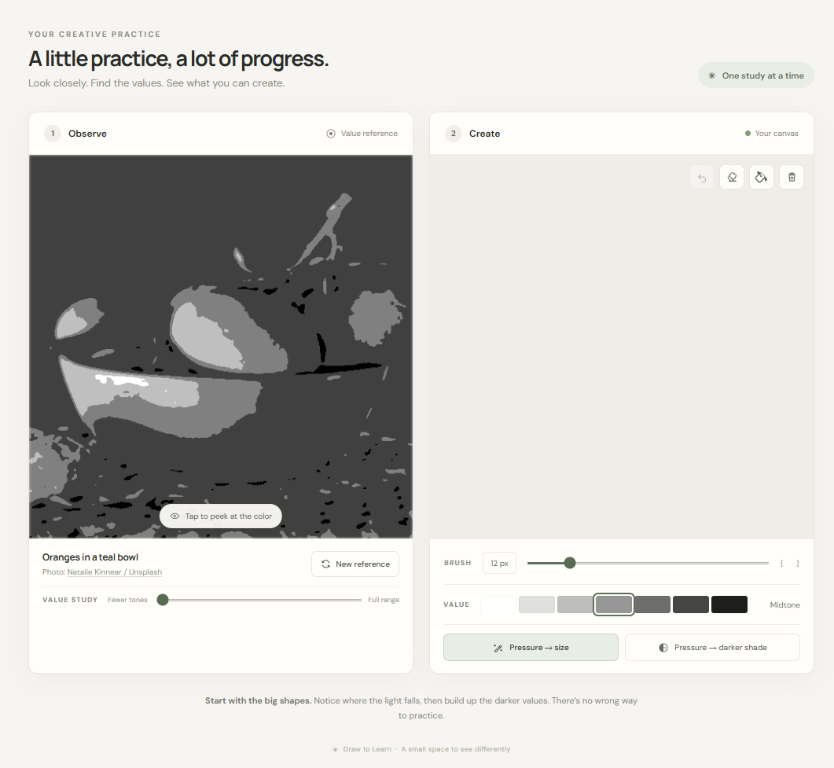

# Draw to Learn

  

Draw to Learn is a simple browser based value study drawing practice app that helps users study light and shadow. It shows real photos in grayscale, lets users simplify them into smooth value shapes, and provides a canvas with grayscale brushes and tablet pressure controls.

## Run locally

Open `index.html` in a modern browser. The app has no build step or required dependencies. An internet connection is needed to load the reference photographs. Google Fonts are optional; the page falls back to system sans-serif fonts.

## Controls

- Draw with a mouse, touchscreen, or pen tablet.
- Use the pressure buttons below the grayscale selector to adjust pen pressure behavior. **Pressure → size** is on by default. Turn on **Pressure → darker shade** to darken harder strokes toward the darkest gray; enable both to vary size and shade together.
- Choose one of seven grayscale values in the value strip.
- Select the paint bucket (`G`) and tap an area to flood-fill its connected region with the chosen gray. On an unmarked canvas, this fills the whole canvas.
- Adjust brush size with the slider or the `[` and `]` keys.
- Click the reference to reveal its color, and click again to return to grayscale.
- Use Undo (`Ctrl+Z` / `Cmd+Z`), the eraser (`E`), or Clear to edit your sketch.
- Choose **New reference** for a different photograph. References cycle in a shuffled order without repeating the three most recent images.
- Use the **Value study** slider beneath the photo credit to adjust the grayscale detail.
